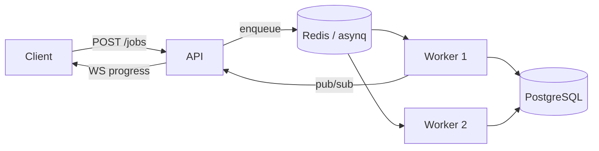

# Go до Middle за 2 месяца

План для backend-разработчика с опытом Python/Django. Цель — не «выучить синтаксис», а
уверенно проектировать, писать, тестировать и эксплуатировать Go-сервисы на уровне middle.

- **Горизонт:** 8 недель
- **Бюджет:** 15–20 ч/нед минимум, 25–30 ч/нед комфортно
- **Формат:** 70% код, 20% чтение, 10% заметки и ревью
- **Результат:** 3 учебных проекта + 1 портфолио-сервис, задеплоенный на VPS
- **Детализация по неделям:** [weekly-plans/](weekly-plans/README.md) — что изучать,
  что делать, где закреплять и что делать по проекту каждый день
- **Проектный трек «ТКП-Советник»:** [projects/tkp-advisor/](projects/tkp-advisor/README.md) —
  бэкенд по кусочкам от домена до упакованного приложения (альтернатива P1–P4
  для реального продукта)

---

## 0. TL;DR

1. Недели 1–3 — язык и конкурентность (проект **P1: CLI**).
2. Недели 4–5 — HTTP и PostgreSQL (проект **P2: REST API**).
3. Неделя 6 — Redis, фоновые задачи, WebSocket (проект **P3: async-сервис**).
4. Неделя 7 — Docker, VPS, observability, CI (P3 в прод).
5. Неделя 8 — capstone, ревью кода, подготовка к интервью (**P4**).
6. Главный риск — не синтаксис, а идиомы: конкурентность, обработка ошибок, указатели/срезы,
   проектирование пакетов. Django-привычки переносятся плохо.

---

## 1. Стартовая точка: что переносится, а что придётся перестроить

### 1.1. Карта Python → Go

| У тебя (Python) | В Go | Комментарий |
|---|---|---|
| `uv`, `pip`, `venv` | `go mod`, `go get`, `go tool` | Виртуальных окружений нет; версии в `go.mod`/`go.sum` |
| `Django` project | `net/http` + `chi` (или stdlib `ServeMux`) | Нет «батареек», всё собирается руками |
| Django ORM | `pgx` + `sqlc` (или GORM) | SQL явный; `sqlc` генерирует типизированный код из SQL |
| DRF serializers | structs + `json`-теги + `validator` | Нет runtime-магии, валидация явная |
| Pydantic | structs + `go-playground/validator` | Нет автоматической валидации при анмаршалинге |
| `manage.py` | `Makefile` / `Taskfile` | Команды проекта — обычные бинарники и скрипты |
| `pytest` | `testing` + `testify` + `httptest` | Табличные тесты, сабтесты, бенчмарки, фаззинг |
| `asyncio` | goroutines + channels + `context` | Другая модель: планировщик и никакого GIL, но есть data race |
| `Celery` | `asynq` (Redis) или `River` (Postgres) | Те же идеи: retries, backoff, dead-letter |
| `redis-py` | `redis/go-redis/v9` | API похож |
| `requests` / `httpx` | `net/http` client | Обязательно таймауты и закрытие Body |
| `uvicorn`/`gunicorn` | сам бинарник + systemd/Docker | Нет отдельного application server |
| `black`/`ruff` | `gofmt`, `goimports`, `golangci-lint` | Форматирование не обсуждается |
| `mypy` | компилятор + `go vet` + `staticcheck` | Типы проверяются на этапе сборки |
| Alembic | `goose` / `golang-migrate` | Миграции — отдельный бинарник/CLI |
| Docker | Docker | Переносится почти 1:1, меняется только сборка |

### 1.2. Что придётся перестроить в голове

- **Ошибки — это значения.** `if err != nil` после каждого шага; исключений нет.
- **Нет наследования.** Только композиция и интерфейсы.
- **Нет `None`-магии.** Нулевые значения (`0`, `""`, `nil`, `false`) — норма, но `nil`-интерфейс
  с типизированным `nil` внутри — ловушка.
- **Срезы — это окно в массив.** `append`, `cap` и алиасинг нужно понять, а не заучить.
- **Конкурентность — не asyncio.** Горутины дешёвые, но требуют дисциплины: `context`,
  `errgroup`, закрытие каналов, отсутствие утечек.
- **Пакеты — единица дизайна.** Циклические импорты невозможны; `internal/` — норма.
- **Простота — идиома.** Generics, интерфейсы и абстракции применяются только по делу.

---

## 2. Целевой профиль middle Go-разработчика

К концу плана ты должен закрывать **все** пункты без подсказок.

### Язык
- [ ] Свободно: срезы, мапы, структуры, методы, указатели, value vs pointer receivers.
- [ ] Интерфейсы: неявная реализация, `io.Reader`/`io.Writer`, «accept interfaces, return structs».
- [ ] Ошибки: обёртка `%w`, `errors.Is/As/Join`, свои типы ошибок, границы `panic/recover`.
- [ ] Generics: когда нужны, constraints, `~`, когда **не** нужны.
- [ ] Идиомы: функциональные опции, embedding, `defer`, `init` (и почему его избегать).

### Конкурентность
- [ ] Горутины, каналы, `select`, `sync`, `atomic`, `context`.
- [ ] Паттерны: worker pool, fan-in/fan-out, pipeline, bounded concurrency, rate limit.
- [ ] Умеешь находить data race и утечки горутин; гоняешь `go test -race`.
- [ ] Graceful shutdown по сигналам и `context`.

### Данные
- [ ] PostgreSQL: схема, индексы, транзакции, изоляция, keyset-пагинация.
- [ ] `pgx`, `database/sql`, пул соединений, `NULL`-значения, `ErrNoRows`.
- [ ] Миграции, сиды, интеграционные тесты с `testcontainers`.
- [ ] Redis: кэш, TTL, очереди, блокировки, `singleflight`.

### HTTP и API
- [ ] `net/http`: сервер, роутинг (включая паттерны Go 1.22+), middleware, лимиты тела.
- [ ] Клиент: таймауты, `Transport`, переиспользование соединений, ретраи.
- [ ] Аутентификация (JWT), валидация, коды ответов, RFC 7807, идемпотентность.
- [ ] WebSocket: upgrade, ping/pong, backpressure, broadcast.

### Эксплуатация
- [ ] Multi-stage Docker, статическая сборка, non-root, `ldflags`-версионирование.
- [ ] Деплой на VPS: systemd/Docker, reverse proxy и TLS, firewall, логи, бэкапы.
- [ ] Observability: `log/slog`, request ID, Prometheus-метрики, health/readiness, pprof.
- [ ] Нагрузочное тестирование (`hey`/`k6`), профилирование, осознанные оптимизации.
- [ ] CI: lint, `vet`, тесты с `-race`, сборка, публикация образа.

### Инженерия
- [ ] Читаешь чужой Go-код и ревьюишь его по чеклисту.
- [ ] Пишешь тесты до/вместе с кодом, умеешь фейки вместо моков.
- [ ] Документируешь решения (README, ADR), не только код.

---

## 3. Общая структура: недели, проекты, гейты

| Неделя | Тема | Проект | Артефакт-гейт |
|---|---|---|---|
| 1 | Синтаксис, тулинг, срезы/мапы/структуры | P1 | P1 работает, есть тесты, `go vet` чист |
| 2 | Интерфейсы, ошибки, generics, тесты | P1 | Идиоматичный код, `golangci-lint` чист |
| 3 | Конкурентность | P1 v2 | Worker pool, нет race и утечек |
| 4 | stdlib, `net/http`, JSON, `slog` | P2 | HTTP-скелет с middleware |
| 5 | PostgreSQL, `sqlc`, auth | P2 | CRUD + auth + интеграционные тесты |
| 6 | Redis, `asynq`, WebSocket | P3 | E2E: job → worker → WS |
| 7 | Docker, VPS, observability, CI | P3 | HTTPS-деплой, метрики, CI |
| 8 | Capstone, ревью, интервью | P4 | Портфолио-сервис + mock-интервью |

**Правило гейта:** неделя не считается закрытой, пока не выполнен артефакт. Лучше урезать
объём проекта, чем протащить долг в следующую неделю.

---

## 4. Недельный план

### Неделя 1 — Синтаксис, инструменты, P1

**Цель:** писать простые программы без гугления базового синтаксиса; освоить тулинг.

| День | Темы | Практика |
|---|---|---|
| 1 | Установка/обновление Go, `go env`, `go mod`, `go run/build/install`, `gofmt`, `gopls` | Обнови `go.mod` (сейчас 1.22.2) до актуальной стабильной версии; переименуй модуль с `main` на `github.com/<you>/go-learn`; hello world + CLI-аргументы |
| 2 | Типы, zero values, конверсии, `const`/`iota`, `if`/`for`/`switch`, `range` | 20 задач на синтаксис: FizzBuzz, строки, числа, массивы |
| 3 | Функции, множественные возвраты, variadic, `defer`, `panic/recover`; указатели `&`/`*` | Напиши утилиты: `minMax`, `parseCSV`, безопасный `divide` с `error` |
| 4 | Массивы vs срезы, `len/cap`, `append`, `copy`, алиасинг; мапы, comma-ok; `strings`, `bytes`, `rune` | 15 упражнений на срезы (особенно `append`-алиасинг) |
| 5 | Структуры, методы, value/pointer receivers, embedding, теги | Модель данных P1 + загрузка URL из файла/флагов |
| 6 | Пакеты, экспорт, `internal/`, структура модуля, `go doc` | Разложи P1 по пакетам `cmd/`, `internal/` |
| 7 | `testing`, табличные тесты, `go test`, `-race`, coverage | Первые тесты P1 + ретроспектива недели |

**Гейт:** P1 запускается, читает вход, имеет тесты, `go vet ./...` и `gofmt -l .` чистые.

---

### Неделя 2 — Интерфейсы, ошибки, generics, качество

**Цель:** писать идиоматичный код, а не «Python с другим синтаксисом».

| День | Темы | Практика |
|---|---|---|
| 1 | Интерфейсы, неявная реализация, `io.Reader/Writer`, пустой интерфейс, type assertion/switch, ловушка nil-интерфейса | Реализуй несколько `io.Writer` (файл, буфер, счётчик) |
| 2 | Ошибки: sentinel, свои типы, `%w`, `errors.Is/As/Join`, когда `panic` уместен | Перепиши ошибки P1 на `errors.Is`/`As` |
| 3 | Композиция vs embedding, обёртки, functional options | Добавь в P1 конфиг через functional options |
| 4 | Generics: параметры типов, constraints, `comparable`, `~`; пакеты `slices`, `maps`, `cmp` | Обобщи `map`/`filter`/`reduce`; пойми, где generics вредны |
| 5 | Тесты: сабтесты, `t.Cleanup`, `t.TempDir`, `httptest`, фейки vs моки, `testify`, golden-файлы, бенчмарки, `benchstat` | Тесты P1 + первый бенчмарк |
| 6 | Layout проекта, нейминг, комментарии, `golangci-lint`, `staticcheck`, `goimports` | Настрой линтер и исправь всё |
| 7 | Рефакторинг P1, README, Makefile | Финальная версия P1 |

**Гейт:** линтер чист, ошибки обёрнуты, интерфейсы минимальны, README объясняет запуск.

---

### Неделя 3 — Конкурентность

**Цель:** писать конкурентный код без гонок, дедлоков и утечек.

| День | Темы | Практика |
|---|---|---|
| 1 | Горутины, планировщик, `GOMAXPROCS`, `WaitGroup`, утечки горутин | 10 маленьких программ + `goleak` в тестах |
| 2 | Каналы: буферизованные/небуферизованные, `close`, `range`, направленные каналы, nil-канал | Реализуй producer/consumer и pipeline |
| 3 | `select`, таймауты, `default`, fan-in/fan-out, worker pool | Конкурентный обход URL с ограничением параллелизма |
| 4 | `sync`: `Mutex`, `RWMutex`, `Once`, `atomic`, `sync.Map`; запрет копирования мьютекса | Счётчик и кэш на разных примитивах + `-race` |
| 5 | `context`: cancel/deadline/value, проброс в HTTP и SQL; `errgroup`, `semaphore` | Отмена всех запросов по сигналу/дедлайну |
| 6 | Паттерны: rate limit (`x/time/rate`), backpressure, graceful shutdown | P1 v2: воркеры, ретраи, лимит RPS, отмена |
| 7 | Профилирование конкурентности: block/mutex profile, бенчмарки последовательно vs параллельно | Отчёт: что ускорилось и почему |

**Гейт:** P1 v2 не имеет гонок (`-race`), не течёт (goleak), корректно завершается по SIGINT.

---

### Неделя 4 — Стандартная библиотека и HTTP

**Цель:** уверенно писать HTTP-сервисы на stdlib, понимать, что дают фреймворки.

| День | Темы | Практика |
|---|---|---|
| 1 | `io`, `os`, `os/fs`, `bufio`, `embed`, `path/filepath`; `encoding/json`: теги, `omitempty`, `RawMessage`, кастомный marshal, стриминг | JSON-утилита: `null` vs `[]`, стриминговый парсер |
| 2 | `time` (Duration, layout, UTC, Timer/Ticker), `math/rand/v2`, базово `crypto` | Парсер дат и генератор ID |
| 3 | `net/http` сервер: `Handler`, `ServeMux` (паттерны `METHOD /path/{id}`), middleware, лимиты тела | Скелет P2 + роутинг |
| 4 | HTTP-клиент: таймауты, `Transport`, переиспользование соединений, `context`, ретраи, закрытие Body | Обёртка-клиент с ретраями и метриками |
| 5 | `log/slog`, уровни, контекстные логгеры; конфиг из env/флагов | Логирование запросов с request ID |
| 6 | Middleware-цепочка: recover, request ID, access log, CORS, timeout; graceful shutdown | Собрать P2-скелет целиком |
| 7 | Тесты HTTP через `httptest`, тесты middleware | Покрыть middleware тестами |

**Гейт:** P2 отвечает на `/healthz`, логи структурированы, сервер корректно останавливается.

---

### Неделя 5 — PostgreSQL, sqlc, аутентификация

**Цель:** довести P2 до полноценного CRUD-сервиса с авторизацией.

| День | Темы | Практика |
|---|---|---|
| 1 | `pgx` vs `database/sql`, DSN, настройка пула (`MaxConns`, lifetime), `Ping`, миграции (`goose`) | Поднять Postgres в Docker, первая миграция |
| 2 | Схема, индексы, транзакции (`BeginTx`), уровни изоляции, `context` в запросах | Схема `users`/`tasks` + индексы |
| 3 | `sqlc`: генерация по SQL, `NULL` (`pgtype`), `ErrNoRows`, bulk insert, keyset-пагинация | Слой стора на `sqlc` |
| 4 | Слои: handler → service → store, DTO ↔ domain, `validator`, маппинг ошибок в HTTP-коды | CRUD + валидация + ошибки |
| 5 | Auth: JWT access/refresh, хеширование паролей (`bcrypt`/`argon2`), middleware, rate limit | Регистрация/логин/защищённые ручки |
| 6 | Интеграционные тесты: `testcontainers-go`, очистка данных, параллельные тесты, `compose` для разработки | Тесты против реального Postgres |
| 7 | Добить P2, README, `.env.example`, Makefile | Демо-сценарий end-to-end |

**Гейт:** P2 поднимается с нуля (`migrate` + `run`), покрыт интеграционными тестами,
работает под `-race`, линтер чист.

---

### Неделя 6 — Redis, фоновые задачи, WebSocket (P3)

**Цель:** воспроизвести привычные тебе Celery + Channels, но на Go.

| День | Темы | Практика |
|---|---|---|
| 1 | `go-redis`: клиент, pipeline, TTL, структуры, cache-aside, `singleflight` | Кэш поверх P2 |
| 2 | `asynq`: постановка задач, воркер, очереди, retries/backoff, dead-letter, периодические задачи | Воркер P3 |
| 3 | Надёжность очередей: идемпотентность, at-least-once, outbox, jitter | Схема `jobs` + статусы |
| 4 | WebSocket (`coder/websocket` или `gorilla`): upgrade, ping/pong, read/write pumps, hub | WS-канал статусов |
| 5 | Broadcast и масштабирование: in-process hub vs Redis pub/sub; когда хватает SSE | Выбор и обоснование в README |
| 6 | Сборка P3: `POST /jobs` → очередь → воркер → прогресс в WS → результат в БД | Сквозной сценарий |
| 7 | Демо и отладка: повторная доставка, падение воркера, дубли | Тесты на retry/идемпотентность |

**Гейт:** job выполняется асинхронно, прогресс виден в WS, падение воркера не теряет задачу.

---

### Неделя 7 — Прод: Docker, VPS, observability, CI

**Цель:** превратить учебный код в сервис, который можно эксплуатировать.

| День | Темы | Практика |
|---|---|---|
| 1 | Multi-stage Dockerfile, `CGO_ENABLED=0`, `-ldflags "-s -w -X main.version=..."`, non-root, distroless | Образ P3 < 30 МБ |
| 2 | Compose «как прод», healthchecks, секреты, миграции отдельным шагом | Локальный прод-стенд |
| 3 | VPS: systemd или Docker, Caddy/Nginx + TLS, firewall, ротация логов, бэкапы | Деплой по HTTPS |
| 4 | Observability: JSON-логи, request ID, Prometheus-метрики (latency, errors, queue depth), `/metrics`, `/healthz`, `/readyz`, pprof только локально/под auth | Дашборд из ключевых метрик |
| 5 | Нагрузка: `hey`/`k6`, профили CPU/heap/block/mutex, `GOMEMLIMIT`, `GOGC` | Отчёт «до/после» оптимизации |
| 6 | CI (GitHub Actions): `gofmt`, `vet`, lint, `test -race`, build, docker; кэш модулей | Зелёный пайплайн |
| 7 | Финальный прогон: перезапуск, отказ Redis/Postgres, проверка алертов | Runbook на 1 страницу |

**Гейт:** сервис доступен по HTTPS, метрики собираются, CI зелёный, есть runbook.

---

### Неделя 8 — Capstone, ревью, интервью

**Цель:** собрать портфолио-проект и проверить себя на вопросы уровня middle.

| День | Темы | Практика |
|---|---|---|
| 1–2 | Capstone: объединить P2+P3 в один сервис, вычистить слои | Единый `cmd/api`, `cmd/worker` |
| 3 | Функциональные пробелы: поиск, фильтры, пагинация, аудит, лимиты | Добить до «продуктового» вида |
| 4 | Саморевью по чеклисту, удаление мёртвого кода, проверка error-path | PR-ревью самому себе |
| 5 | Нагрузка + профилирование + README/ADR/схема архитектуры | Публикация репозитория |
| 6 | Подготовка к интервью: язык, конкурентность, БД, HTTP, системы; mock-интервью | 30 вопросов вслух |
| 7 | Ретроспектива, план на следующие 3 месяца | Обновить `learning-log.md` |

**Гейт:** репозиторий с README, тестами, CI, Docker, деплоем и разделом «что бы улучшил».

---

## 5. Проекты

### P1 — CLI `urlcheck` (недели 1–3)

**Зачем:** синтаксис, срезы/мапы, структуры, интерфейсы, ошибки, конкурентность, тесты.

**Требования:**
- Вход: список URL из файла и/или аргументов.
- Флаги: `-c` (параллелизм), `-timeout`, `-deadline`, `-rps`, `-retries`, `-o table|json`.
- Ограниченный worker pool, отмена по `context`, ретраи с backoff на 5xx/429.
- Итог: статусы, коды, задержки; exit code `1`, если есть ошибки.
- Пакеты: `cmd/`, `internal/checker`, `internal/report`.
- Тесты: табличные + `httptest` + `-race` + `goleak`.
- Бенчмарк: последовательно vs параллельно, вывод через `benchstat`.
- Makefile: `build`, `test`, `lint`, `bench`.

**Критерии приёмки:**
- [ ] Нет гонок и утечек горутин.
- [ ] Корректная отмена: Ctrl+C завершает всё за секунды.
- [ ] Линтер и `vet` чистые, покрытие основных веток тестами.
- [ ] README: примеры запуска и флагов.

---

### P2 — REST API `tasks` (недели 4–5)

**Зачем:** HTTP, PostgreSQL, слои, auth, интеграционные тесты — ядро backend-работы.

**Требования:**
- Ресурсы: `users`, `tasks`. CRUD, фильтры, сортировка, пагинация (keyset).
- PostgreSQL + миграции (`goose`), доступ через `pgx` + `sqlc`.
- Middleware: request ID, structured log, recover, timeout, CORS, rate limit.
- JWT access/refresh, хеширование паролей, ролевая проверка владельца.
- Валидация входа, ошибки в формате RFC 7807, корректные коды.
- Graceful shutdown, `/healthz`, `/readyz`, конфиг из env.
- Интеграционные тесты с `testcontainers-go`.
- `docker-compose.yml` (app + postgres), Makefile, OpenAPI (опционально).

**Критерии приёмки:**
- [ ] Развёртывание с нуля одной командой.
- [ ] Тесты проходят с `-race`, БД поднимается в контейнере.
- [ ] Секреты не в коде, `.env.example` актуален.
- [ ] Документированы ручки и модель ошибок.

**Структура:**
```
cmd/api/main.go
internal/config/
internal/httpapi/     # handlers, middleware, router
internal/service/     # бизнес-логика
internal/store/       # pgx + sqlc
migrations/
queries/
docker-compose.yml
```

---

### P3 — Async-сервис `jobs` (неделя 6, прод — 7)

**Зачем:** воспроизвести Celery/Redis/WebSocket-опыт и научиться надёжности.

**Требования:**
- `POST /jobs` → `202 Accepted` + `job_id`.
- Очередь `asynq` в Redis, отдельный бинарник `cmd/worker`.
- Задача: например, отправка webhook или генерация отчёта (2–5 секунд работы).
- Статусы: `pending`/`running`/`done`/`failed`, прогресс в процентах.
- Retries с backoff и jitter, dead-letter, идемпотентность по ключу.
- `GET /jobs/{id}` + `WS /jobs/{id}/events` для live-прогресса.
- Метрики: длина очереди, длительность, ошибки, ретраи.
- Graceful shutdown воркера (не терять in-flight задачи).

**Критерии приёмки:**
- [ ] Убийство воркера посреди задачи → задача переотдаётся и завершается.
- [ ] Повторный `POST` с тем же idempotency key не создаёт дубль.
- [ ] WS-клиент видит прогресс и финальный статус.
- [ ] Метрики отражают реальное состояние очереди.

**Архитектура:**


---

### P4 — Capstone (неделя 8)

**Зачем:** показать связный production-сервис, а не набор упражнений.

**Варианты (выбери один):**
1. **Webhook-платформа:** подписки, доставка с ретраями, история, подпись HMAC, дашборд статусов.
2. **Сервис отчётов:** загрузка CSV, асинхронная обработка, прогресс, хранение результатов.
3. **Мини-очередь задач с UI:** проекты, задачи, исполнители, аудит, live-обновления.

**Обязательный минимум:**
- [ ] API + воркер + Postgres + Redis.
- [ ] Auth, валидация, лимиты, идемпотентность.
- [ ] Метрики, structured-логи, health/readiness, pprof под защитой.
- [ ] Docker + CI + деплой на VPS по HTTPS.
- [ ] Интеграционные тесты и хотя бы один бенчмарк.
- [ ] README: архитектура, запуск, решения и компромиссы, «что дальше».
- [ ] Нагрузочный отчёт: RPS, p95/p99, узкие места, что оптимизировал.

---

## 6. Ежедневный ритм

Шаблон на 3 часа:

| Блок | Время | Что делать |
|---|---|---|
| Теория | 30–40 мин | Одна тема, только официальные источники + 1 глава книги |
| Код | 90 мин | Задача/проект, без копипаста из туториала |
| Тесты и рефакторинг | 30 мин | Тесты, `vet`, lint, переписать «как надо» |
| Заметки | 15 мин | 3 строки в `learning-log.md` |

**`learning-log.md` — 3 строки в день:**
1. Что сделал и что заработало.
2. Где залип и как решил (или не решил).
3. Что занести в `go-gotchas.md`.

**Правило «без туториала»:** каждый проект после первого дня делается по документации
`pkg.go.dev`, а не по видео. Если копируешь — переписывай своими словами и добавляй тест.

---

## 7. Тестирование и качество

| Инструмент | Когда | Обязательно |
|---|---|---|
| `testing` + табличные тесты | всегда | да |
| `t.Cleanup`, `t.TempDir` | ресурсы в тестах | да |
| `httptest` | HTTP-хендлеры и клиенты | да |
| `go test -race` | любой конкурентный код | да |
| `goleak` | тесты с горутинами | да |
| `testcontainers-go` | интеграционные тесты с БД | да |
| `testify` | ассерты и `require` | по вкусу |
| `go test -bench` + `benchstat` | оптимизации | да для P1/P3 |
| `go test -fuzz` | парсеры, валидаторы | по желанию |
| `go vet`, `staticcheck`, `golangci-lint` | каждый коммит/CI | да |
| `go tool cover` | раз в неделю | да |

**Принципы:**
- Фейки предпочтительнее моков; моки — только на границах (внешние API).
- Тест не должен требовать запуска всего сервиса, если можно протестировать слой.
- Каждый баг → сначала воспроизводящий тест, потом фикс.
- Ошибки — часть контракта: тестируй и успех, и отказ.

---

## 8. Прод: чеклист production readiness

- [ ] Один статический бинарник, `CGO_ENABLED=0`, версия через `-ldflags`.
- [ ] Docker multi-stage, non-root пользователь, маленький образ.
- [ ] Конфиг только из env, секреты не в образе и не в git.
- [ ] Graceful shutdown API и воркера по SIGTERM с таймаутом.
- [ ] `/healthz` (жив) и `/readyz` (готов принимать трафик) разделены.
- [ ] Таймауты на всех внешних вызовах: HTTP-клиент, БД, Redis.
- [ ] Лимиты: тело запроса, размер очереди, параллелизм, rate limit.
- [ ] Structured-логи с request ID и уровнем; без секретов в логах.
- [ ] Метрики: latency, error rate, saturation (пул БД, очередь).
- [ ] pprof недоступен из интернета.
- [ ] Миграции применяются отдельным шагом, обратимы или задокументированы.
- [ ] Бэкапы БД и проверка восстановления.
- [ ] Runbook: что делать при падении Redis/Postgres, как откатить релиз.

---

## 9. Gotchas, которые нужно закрыть до middle

Заноси в `go-gotchas.md` с примером кода и выводом.

### Данные
- `nil`-срез и пустой срез: `json.Marshal` даёт `null` vs `[]`.
- `append` может переиспользовать массив → алиасинг и «магические» изменения.
- `cap` и рост среза; `copy` vs `append`.
- Итерация по мапе неупорядочена; `range` по мапе даёт копии.
- `for i, v := range sliceOfStructs` — `v` это копия (и семантика `i` изменилась в Go 1.22).
- Строки — UTF-8 байты; `len` в байтах, `runes` для символов.
- `time.Time` в JSON, монотонные часы, сравнение через `Equal`.
- `omitempty` не работает для нулевых значений так, как ждёшь (и не различает 0 и «нет»).

### Ошибки и интерфейсы
- `nil`-указатель в интерфейсе ≠ `nil`-интерфейс.
- `%w` только один раз на цепочку в старых версиях; используй `errors.Join` для нескольких.
- Сравнение ошибок строками — антипаттерн; `errors.Is/As`.
- `panic` только на границах (main, middleware recover).
- «Accept interfaces, return structs»; интерфейсы на стороне потребителя.
- `init()` и глобальное состояние усложняют тесты.

### Конкурентность
- `WaitGroup.Add` до старта горутины, не внутри.
- Копирование `sync.Mutex` ломает блокировку (передавай указатель).
- Незакрытый канал / чтение из закрытого / запись в закрытый.
- Горутина навсегда ждёт канал → утечка; всегда есть путь отмены.
- `context` не хранят в структуре; передают первым аргументом.
- `time.After` в цикле и таймеры — думай о ресурсах.
- `-race` обязателен: баги конкурентности не воспроизводятся стабильно.

### HTTP / SQL / прод
- Забыл `resp.Body.Close()` → утечка соединений.
- `http.Client` без таймаута = бесконечное ожидание.
- `http.DefaultClient` в проде без настройки `Transport`.
- `rows.Close()` и проверка `rows.Err()`.
- `NULL` в БД → `pgtype`/указатели, а не молчаливый `""`.
- `SELECT *` и рассинхрон со структурой; явные колонки.
- N+1 запросы при обходе списка.
- `defer` в цикле накапливает вызовы до выхода из функции.
- `math/rand` для безопасности — нельзя, только `crypto/rand`.
- Глобальные переменные-«конфиги» вместо внедрения зависимостей.

---

## 10. Ресурсы

**База (читать по неделям, не всё сразу):**
- A Tour of Go — быстрый проход синтаксиса.
- Effective Go — идиомы и стиль.
- Go by Example — короткие рабочие примеры по темам.
- Go Code Review Comments и официальный Style Guide — как писать «как все».
- Спецификация языка — справочник по спорным вопросам.

**Практика и углубление:**
- Learn Go with Tests — TDD-подход, хорошо для недель 2–3.
- «100 Go Mistakes and How to Avoid Them» — идеально для недель 2–4 и 8.
- «Let's Go» / «Let's Go Further» (Alex Edwards) — структура веб-сервиса и прод-практики.
- «The Go Programming Language» (Donovan, Kernighan) — глубокая база, выборочно.

**Документация и экосистема:**
- `pkg.go.dev` — документация пакетов, читать исходники stdlib.
- Go Blog — конкурентность, планировщик, профилирование, новые версии.
- Awesome Go — выбор библиотек; смотри на поддержку и звёзды, но проверяй API сам.
- Go Time (подкаст) — контекст индустрии, слушать в дороге.

**Инструменты:**
- `golangci-lint`, `staticcheck`, `goimports`, `air` (hot reload), `dlv` (debugger),
  `hey`/`k6`, `benchstat`, `goleak`, `testcontainers-go`.

---

## 11. Вопросы для самопроверки

Отвечай вслух, без подглядывания. Если «плаваешь» — возвращайся к теме.

**Язык**
1. Чем срез отличается от массива и что такое `cap`?
2. Почему `append` в цикле может изменить исходный срез?
3. Когда receiver делают указателем, а когда значением?
4. Что такое nil-интерфейс с типизированным nil внутри?
5. Чем `errors.Is` отличается от `errors.As`?
6. Когда generics оправданы, а когда это оверинжиниринг?
7. Почему `init()` и глобальные переменные мешают тестам?

**Конкурентность**
8. Чем буферизованный канал отличается от небуферизованного на практике?
9. Как выглядит утечка горутин и как её предотвратить?
10. Зачем `context` передают первым аргументом?
11. Как реализовать worker pool с ограничением и отменой?
12. Почему `-race` не гарантирует отсутствие гонок в проде?
13. Что делает `errgroup.WithContext` при первой ошибке?

**Данные и API**
14. Как выбрать между `database/sql`, `pgx` и GORM?
15. Как настроить пул соединений под нагрузку?
16. Чем keyset-пагинация лучше offset?
17. Как обрабатывать `NULL` из БД в Go?
18. Как спроектировать идемпотентный `POST`?
19. Где ставить таймауты: клиент, сервер, БД, очередь?
20. Как связаны `readyz` и применение миграций?

**Прод**
21. Зачем `CGO_ENABLED=0` в Docker?
22. Как пробросить версию сборки в бинарник?
23. Что показывает pprof и какие профили бывают?
24. Как найти узкое место под нагрузкой, не гадая?
25. Что произойдёт при SIGTERM с in-flight запросами и задачами?

**Системный дизайн**
26. Как масштабировать воркеры и WS-подписки на несколько инстансов?
27. Где хранить состояние WebSocket-сессий?
28. Как гарантировать доставку задачи хотя бы один раз и не сделать дублей?
29. Как кэшировать без «стампеда»?
30. Какой у тебя план деградации при падении Redis?

---

## 12. Риски и план Б

| Риск | Симптом | Что делать |
|---|---|---|
| Перенос Python-паттернов 1:1 | «Где ORM?», классы-наследование, исключения | Недели 2–3: читать Effective Go и ревьюить свой код |
| Фреймворк вместо понимания | Сразу Gin/Echo/GORM | Сначала stdlib + `chi`/`sqlc`; фреймворк — после P2 |
| Копипаст конкурентности | Гонки, дедлоки, «иногда работает» | Всегда `-race`, goleak, маленькие примеры |
| Tutorial hell | 10 курсов, 0 своих проектов | Гейты: без артефакта неделя не закрыта |
| Не хватает времени | Отставание на 1–2 недели | Урезать P1 (без ретраев), P4 сделать эволюцией P3 |
| «Middleware-сервис» вместо архитектуры | Всё в `main.go` | Слои с недели 5, ревью структуры в конце недели |

**Варианты темпа:**

| Часов в неделю | Срок | Что меняется |
|---|---|---|
| 10–12 | ~3 месяца | P4 не делаем, P3 без WS |
| 15–20 | 2 месяца | План как есть, P4 — минимальный |
| 25–30 | 7–8 недель | P4 полноценный, плюс чтение stdlib |

**Если цель — строго backend-middle:** не углубляйся в generics, reflection, `unsafe`, cgo,
DI-контейнеры и написание своего фреймворка. Это следующий этап.

---

## 13. Шпаргалка команд

```bash
# модуль и зависимости
go mod init github.com/<you>/go-learn
go get github.com/jackc/pgx/v5
go mod tidy
go list -m all

# запуск и сборка
go run ./cmd/api
go build -o bin/api ./cmd/api
go build -ldflags "-s -w -X main.version=$(git describe --tags --always)" ./cmd/api

# тесты и качество
go test ./... -race -count=1
go test ./internal/store -run TestCreate -v
go test ./... -coverprofile=cover.out && go tool cover -html=cover.out
go test -bench . -benchmem ./internal/checker
go test -fuzz FuzzParse -fuzztime=30s
go vet ./...
gofmt -l -w .
goimports -w .
golangci-lint run

# диагностика
go doc fmt.Println
go env -w GOTOOLCHAIN=auto
go version
dlv debug ./cmd/api
go tool pprof -http=:8080 cpu.out
go tool trace trace.out
```

**Полезные переменные окружения:** `GOMAXPROCS`, `GOMEMLIMIT`, `GOGC`, `GOTOOLCHAIN`.

---

## 14. Итоговый чеклист «я middle»

- [ ] Написал и задеплоил сервис с нуля без туториала.
- [ ] Объясняю модель конкурентности Go и пишу код без гонок.
- [ ] Проектирую схему БД, миграции и слой доступа с типизированными запросами.
- [ ] Пишу тесты всех уровней, включая интеграционные и бенчмарки.
- [ ] Читаю профили и оптимизирую по данным, а не по интуиции.
- [ ] Эксплуатирую сервис: логи, метрики, health, graceful shutdown, алерты.
- [ ] Ревьюю чужой Go-код и аргументирую замечания идиомами, а не вкусом.
- [ ] Знаю, когда НЕ использовать интерфейсы, generics, ORM и фреймворк.
- [ ] Могу рассказать о компромиссах в своём проекте на интервью.

---

_Обновляй этот план по ходу: отмечай гейты, переноси темы, фиксируй отклонения в
`learning-log.md`, а ловушки — в `go-gotchas.md`._
